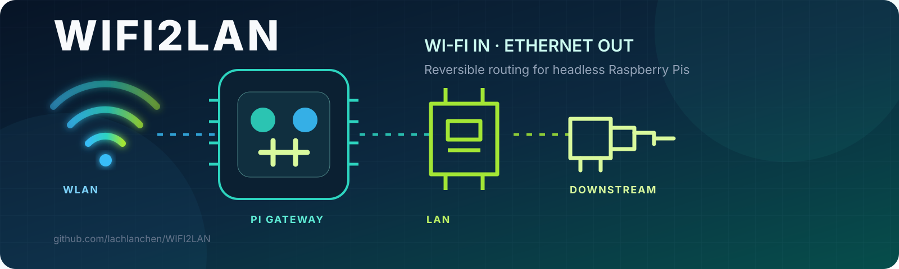

[English](../README.md) · [العربية](README.ar.md) · [Español](README.es.md) · [Français](README.fr.md) · [日本語](README.ja.md) · [한국어](README.ko.md) · [Tiếng Việt](README.vi.md) · [中文 (简体)](README.zh-Hans.md) · [中文（繁體）](README.zh-Hant.md) · [Deutsch](README.de.md) · [Русский](README.ru.md)

# WIFI2LAN

**Cổng Wi-Fi sang Ethernet bền vững cho Raspberry Pi chạy không màn hình.**

WIFI2LAN biến kết nối Wi-Fi của Raspberry Pi thành đường Ethernet được quản lý.
Dự án cung cấp hai cấu hình có thể tái tạo và hoàn tác: cổng Pi 4B tại
`192.168.13.1`, và Pi 5 có thể chuyển an toàn giữa máy khách LAN thông thường
với cấu hình bộ định tuyến đã lưu.

## Điểm nổi bật

- `arm` chờ ngắt Ethernet rồi mới khởi động DHCP.
- Mỗi thay đổi tạo bản sao lưu có dấu thời gian trong `/var/backups`.
- NAT, DNS, DHCP, chuyển tiếp và dịch vụ khởi động được cấu hình đồng bộ.
- SSH và VNC vẫn truy cập được từ mạng phía sau.
- Mật khẩu Wi-Fi không được lưu trong kho mã.

## Thành phần

- [`pi4-router`](../pi4-router/): cổng Wi-Fi sang LAN cho Pi 4B.
- [`pi5-client`](../pi5-client/): chuyển chế độ máy khách/bộ định tuyến cho Pi 5.

Hãy đọc [tài liệu tiếng Anh đầy đủ](../README.md) trước khi thay đổi mạng vì thao
tác có thể làm gián đoạn truy cập từ xa.

## Ủng hộ

| Quyên góp | PayPal | Stripe |
| --- | --- | --- |
|  |  |  |
